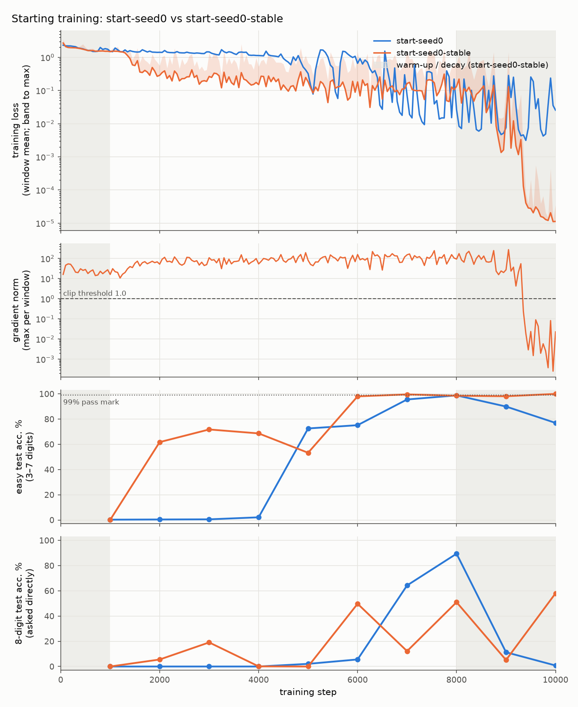

# Results

Measurements from every training run, kept in git. Checkpoints stay in `runs/` (ignored by git: hundreds of MB per run); here we keep only what is needed to re-read the evidence.

| File | What it is |
| --- | --- |
| `summary.md` | Generated tables per run: settings, accuracy at each evaluation, spike statistics. Do not edit by hand |
| `evals.csv` | Every evaluation of every run, one row per run, step, test set and group |
| `runs/<run>/config.json` | Exact model and training settings, device, torch version, dataset fingerprints |
| `runs/<run>/log.jsonl` | The full training log: loss, gradient norm, learning rate, accuracies, timings |
| `plots/*.png` | Training curves (loss, gradient norm, easy and 8-digit accuracy), from `uv run python -m gainpred.plots RUN [RUN]` |

## Datasets

Generated by `uv run python -m gainpred.data` into `data/addition/` (not in git; rebuilt identically from the seeds, with fingerprints frozen in `tests/test_data.py`). Every problem adds two numbers of the **same length**, e.g. `Q: 6133 + 8894 = ?` → `A: 15027`. Digits are drawn at random, and no number starts with 0. Problems are unique within a set, and the test sets are generated first, so **no training problem appears in any test set**.

| Set | Used for | Lengths | Size | Seed | Extra rules |
| --- | --- | --- | --- | --- | --- |
| `train_start` | **Training** in starting training (P1) | 3–7 ("easy") | 50,000 per length = 250,000 | 2001 | – |
| `test_easy` | **Test**: the "easy" columns, check 0 (pass mark 99%) | 3–7 | 1,000 per length = 5,000 | 1003 | – |
| `test_study` | **Test**: the "8 / 9" columns (starting point, P9) and later all hard-size results | 8–15 ("hard") | 1,000 per length × carry group = 16,000 | 1001 | No piece starts with 0 under any of the three cuts (P4); split by whether a carry crosses cut 1 |
| `test_reproduction` | **Test**: comparison with Shin et al.'s curves (not used yet) | 3–15 | 100 per length = 1,300 | 1002 | Only the no-leading-zero rule |

**All accuracies in these results are on test sets**, which the model never trains on. Training performance appears only as the loss (the stability tables and `log.jsonl`), averaged over training batches. The starting-training evaluation uses only the 8- and 9-digit groups of `test_study`. "Carry" means some lower piece's sum overflows its width under cut 1 (8 digits: 4∣4; 9 digits: 3∣6), so naively joining the piece sums would be wrong.

## Rebuilding after a new run

After a new run, download it and rebuild:

```sh
uv run modal volume get gainpred runs/NAME runs/
uv run python -m gainpred.report
```

## The runs so far

All are P1 starting training on easy addition (3–7 digits), seed 0, batch 256. "Easy" is check 0 on the easy test set; "8 digits" is the starting-point test (P9), asked directly with no cutting.

| Run | Date | Where | Purpose | Outcome |
| --- | --- | --- | --- | --- |
| `quick-m2` | 13 Nov 2026 | Laptop (M2, MPS) | Wiring check: 300 steps, 200 test problems per length | Ran end to end, 0% (expected this early); ~1.2 steps/s on the laptop |
| `local-1500` | 13 Nov 2026 | Laptop (M2, MPS) | Longer laptop run | Stopped at step 800 in favour of Modal; still 0% |
| `start-seed0` | 13 Nov 2026 | Modal, NVIDIA A10 (config says only `cuda`; the device name was not yet recorded) | Full P1 recipe as stated: constant learning rate, no clipping | **Failed P9.** Easy peaked at 98.8% (step 8,000) then fell to 77.0% after loss spikes |
| `start-seed0-stable` | 13 Nov 2026 | Modal, NVIDIA A10 | Same, plus warmup-stable-decay schedule and clipping at 1.0 from Lee et al.'s code (P10) | **Passes P9:** easy 100.0% (7 digits 99.9%). 8 digits directly: 59.9% / 56.2%; 9 digits: 0% |

## What we take from them



- **Stability.** With a constant learning rate the model learns, then repeatedly forgets long problems. Warm-up, clipping and a final decay fix the *end point*, but spikes still occur in the stable phase (gradient norm up to ~240 before clipping, easy accuracy swinging between 53% and 99.6%); the decay phase settles them. Seed 1 has not been run yet, so we do not know whether 100% is reliable.
- **8 digits are not "close to 0%".** Both runs answer many 8-digit problems directly at some checkpoints (up to ~90%), with no carry/no-carry difference, so the model is not using cut-1 structure. The share swings widely between checkpoints (stable run: 0–60%), and the final value depends on where training stops (start-seed0 ended at 0.9%, the stable run at 58%). Nine digits stay at ~0% throughout. How to treat this against P9 is an open protocol decision.
