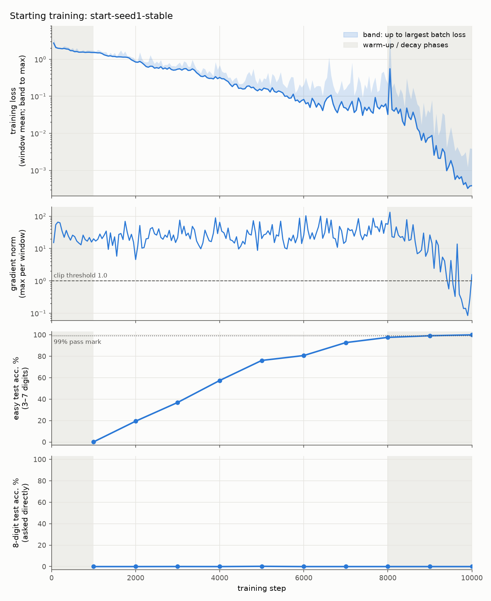

# Results

<!-- status:start -->
## Status

Generated by `uv run python -m gainpred.status`; do not edit by hand. Rules: `docs/runbook.md`.

**Spending (estimate):** $50.47 of the $80 budget.

**Tripwires**

| Tripwire | State |
| --- | --- |
| No-carry rule below 90% at a length (four-round runs) | ok (6 runs checked) |
| A standard starting model under 99% on easy problems | ok (5 models checked) |
| Overlap between test and training problems | ok by construction (exclusion tested); kept round problems are not stored, so not re-checked |
| A rerun differs from its original by over 3 points | ok (si-their-seed1-r1 vs si-nocarry-seed1 round 1: max 0.5, si-nocarry-seed1 vs si-nocarry-seed1-v2 round 1: max 2.9, si-nocarry-seed1 vs si-nocarry-seed1-v2 round 2: max 1.7) |
| Checks computed after training | ok (log order checked) |

**Decisions waiting for the owner**

- None. Decision point 2 signed 15 November 2026 (https://claude.ai/artifact/UkkhhEXd7YH1bkB6vTPxHx). Phase C (results material for the write-up) in progress.
- **R1 wording, open item for the owner:** the signed sentence "models near 60% did nothing, none did harm" does not match the cells; see `results/dp1_log.md`, decision point 2.

**Every run**

| Run | State | GPU minutes | Note |
| --- | --- | --- | --- |
| `check3-si-agreement-seed0-5cut` | done | 3 |  |
| `check3-si-agreement-seed0-authors` | done | 3 |  |
| `check3-si-agreement-seed0-authors-3cut` | done | 1 |  |
| `check3-si-agreement-seed1-5cut` | done | 3 |  |
| `check3-si-agreement-seed1-authors` | done | 3 |  |
| `check3-si-agreement-seed1-authors-3cut` | done | 1 |  |
| `check3-si-agreement-seed2-authors` | done | 3 |  |
| `check3-si-agreement-seed3-authors` | done | 3 |  |
| `check3-si-agreement-seed4-authors` | done | 3 |  |
| `check3-si-nocarry-seed0-5cut` | done | 2 |  |
| `check3-si-nocarry-seed0-authors` | done | 2 |  |
| `check3-si-nocarry-seed0-authors-3cut` | done | 1 |  |
| `check3-si-nocarry-seed1-5cut` | done | 2 |  |
| `check3-si-nocarry-seed1-authors` | done | 2 |  |
| `check3-si-nocarry-seed1-authors-3cut` | done | 1 |  |
| `check3-si-nocarry-seed2-authors` | done | 2 |  |
| `check3-si-nocarry-seed3-authors` | done | 2 |  |
| `check3-si-nocarry-seed4-authors` | done | 2 |  |
| `check3-si-nocarry-weak-s1425-seed2-r2` | done | 0 |  |
| `check3-si-nocarry-weak-s2200-seed2` | done | 0 |  |
| `check3-si-nocarry-weak-s2250-seed1` | done | 0 |  |
| `check3-si-nocarry-weak-s2250-seed4` | done | 0 |  |
| `check3-si-nocarry-weak-s2500-seed1` | done | 0 |  |
| `check3-si-nocarry-weak-s3000-seed4` | done | 0 |  |
| `check3-si-nocarry-weak-s3400-seed1` | done | 0 |  |
| `check3-si-nocarry-weak-s3450-seed3` | done | 0 |  |
| `check3-si-nocarry-weak-s3500-seed1` | done | 0 |  |
| `check3-si-nocarry-weak-s3500-seed3` | done | 0 |  |
| `check3-si-noselect-after-nocarry-seed0-authors` | done | 1 |  |
| `check3-si-noselect-after-nocarry-seed0-authors-3cut` | done | 0 |  |
| `check3-si-noselect-after-nocarry-seed1-authors` | done | 1 |  |
| `check3-si-noselect-after-nocarry-seed1-authors-3cut` | done | 0 |  |
| `check3-si-noselect-after-nocarry-seed2-authors` | done | 1 |  |
| `check3-si-noselect-after-nocarry-seed3-authors-r2` | done | 1 |  |
| `check3-si-noselect-after-nocarry-seed4-authors` | done | 1 |  |
| `check3-si-noselect-seed0-5cut` | done | 2 |  |
| `check3-si-noselect-seed0-authors` | done | 2 |  |
| `check3-si-noselect-seed0-authors-3cut` | done | 1 |  |
| `check3-si-noselect-seed1-5cut` | done | 2 |  |
| `check3-si-noselect-seed1-authors` | done | 2 |  |
| `check3-si-noselect-seed1-authors-3cut` | done | 1 |  |
| `check3-si-noselect-seed2-authors` | done | 2 |  |
| `check3-si-noselect-seed3-authors` | done | 2 |  |
| `check3-si-noselect-seed4-authors` | done | 2 |  |
| `check3-si-vote-seed0-5cut` | done | 3 |  |
| `check3-si-vote-seed0-authors` | done | 4 |  |
| `check3-si-vote-seed1-5cut` | done | 3 |  |
| `check3-si-vote-seed1-authors` | done | 4 |  |
| `check3-si-vote-seed2-authors` | done | 3 |  |
| `check3-si-vote-seed3-authors` | done | 4 |  |
| `check3-si-vote-seed4-authors` | done | 3 |  |
| `control-answers` | done | 1 |  |
| `local-1500` | stopped | 13 | laptop run stopped at step 800 in favour of Modal |
| `probe-runs-edges_differ-seed2-u30000` | done | 1 |  |
| `probe-runs-edges_differ-seed3-u30000` | done | 1 |  |
| `probe-runs-edges_differ-seed4-u30000` | done | 1 |  |
| `probe-runs-join_at_the_cut-seed2-u30000` | done | 1 |  |
| `probe-runs-join_at_the_cut-seed3-u30000` | done | 1 |  |
| `probe-runs-join_at_the_cut-seed4-u30000` | done | 1 |  |
| `probe-runs-join_at_the_cut-withheld-seed2-longruns` | done | 1 |  |
| `probe-runs-join_at_the_cut-withheld-seed2-u30000` | done | 1 |  |
| `probe-runs-join_at_the_cut-withheld-seed3-longruns` | done | 1 |  |
| `probe-runs-join_at_the_cut-withheld-seed3-u30000` | done | 1 |  |
| `probe-runs-join_at_the_cut-withheld-seed4-longruns` | done | 1 |  |
| `probe-runs-join_at_the_cut-withheld-seed4-u30000` | done | 1 |  |
| `probe-runs-pick_the_longer-seed2-u30000` | done | 1 |  |
| `probe-runs-pick_the_longer-seed3-u30000` | done | 1 |  |
| `probe-runs-pick_the_longer-seed4-u30000` | done | 1 |  |
| `probe-si-agreement-seed0-5cut` | failed | 14 | container stopped part-way without an error of its own; Modal's retry then refused the existing folder (FileExistsError); partial output kept, not scored; replaced as a whole by probe-si-agreement-seed0-5cut-r2 (owner approved, 15 Nov 2026) |
| `probe-si-agreement-seed0-5cut-r2` | done | 20 |  |
| `probe-si-agreement-seed0-authors` | done | 6 |  |
| `probe-si-agreement-seed1-5cut` | failed | 12 | container stopped part-way without an error of its own; Modal's retry then refused the existing folder (FileExistsError); partial output kept, not scored; replaced as a whole by probe-si-agreement-seed1-5cut-r2 (owner approved, 15 Nov 2026) |
| `probe-si-agreement-seed1-5cut-r2` | done | 20 |  |
| `probe-si-agreement-seed1-authors` | done | 6 |  |
| `probe-si-agreement-seed2-authors` | failed | 6 | container stopped part-way without an error of its own; Modal's retry then refused the existing folder (FileExistsError); partial output kept, not scored; replaced as a whole by probe-si-agreement-seed2-authors-r2 (owner approved, 15 Nov 2026) |
| `probe-si-agreement-seed2-authors-r2` | done | 25 |  |
| `probe-si-agreement-seed3-authors` | done | 25 |  |
| `probe-si-agreement-seed4-authors` | done | 25 |  |
| `probe-si-nocarry-seed0-5cut` | done | 6 |  |
| `probe-si-nocarry-seed0-authors` | done | 3 |  |
| `probe-si-nocarry-seed1-5cut` | done | 6 |  |
| `probe-si-nocarry-seed1-authors` | done | 3 |  |
| `probe-si-nocarry-seed2-authors` | failed | 6 | container stopped part-way without an error of its own; Modal's retry then refused the existing folder (FileExistsError); partial output kept, not scored; replaced as a whole by probe-si-nocarry-seed2-authors-r2 (owner approved, 15 Nov 2026) |
| `probe-si-nocarry-seed2-authors-r2` | done | 8 |  |
| `probe-si-nocarry-seed3-authors` | failed | 0 | container stopped part-way without an error of its own; Modal's retry then refused the existing folder (FileExistsError); partial output kept, not scored; replaced as a whole by probe-si-nocarry-seed3-authors-r2 (owner approved, 15 Nov 2026) |
| `probe-si-nocarry-seed3-authors-r2` | done | 9 |  |
| `probe-si-nocarry-seed4-authors` | done | 8 |  |
| `probe-si-nocarry-weak-s1425-seed2-r2` | done | 1 |  |
| `probe-si-nocarry-weak-s2200-seed2` | done | 1 |  |
| `probe-si-nocarry-weak-s2250-seed1` | done | 1 |  |
| `probe-si-nocarry-weak-s2250-seed4` | done | 1 |  |
| `probe-si-nocarry-weak-s2500-seed1` | done | 1 |  |
| `probe-si-nocarry-weak-s3000-seed4` | done | 1 |  |
| `probe-si-nocarry-weak-s3400-seed1` | done | 1 |  |
| `probe-si-nocarry-weak-s3450-seed3` | done | 1 |  |
| `probe-si-nocarry-weak-s3500-seed1` | done | 1 |  |
| `probe-si-nocarry-weak-s3500-seed3` | done | 1 |  |
| `probe-si-noselect-after-nocarry-seed0-authors` | done | 2 |  |
| `probe-si-noselect-after-nocarry-seed1-authors` | done | 2 |  |
| `probe-si-noselect-after-nocarry-seed2-authors` | done | 2 |  |
| `probe-si-noselect-after-nocarry-seed3-authors-r2` | done | 2 |  |
| `probe-si-noselect-after-nocarry-seed4-authors` | done | 2 |  |
| `probe-si-noselect-seed0-5cut` | done | 4 |  |
| `probe-si-noselect-seed0-authors` | done | 2 |  |
| `probe-si-noselect-seed1-5cut` | done | 4 |  |
| `probe-si-noselect-seed1-authors` | done | 2 |  |
| `probe-si-noselect-seed2-authors` | failed | 6 | container stopped part-way without an error of its own; Modal's retry then refused the existing folder (FileExistsError); partial output kept, not scored; replaced as a whole by probe-si-noselect-seed2-authors-r2 (owner approved, 15 Nov 2026) |
| `probe-si-noselect-seed2-authors-r2` | done | 6 |  |
| `probe-si-noselect-seed3-authors` | done | 6 |  |
| `probe-si-noselect-seed4-authors` | done | 6 |  |
| `probe-si-vote-seed0-5cut` | failed | 16 | container stopped part-way without an error of its own; Modal's retry then refused the existing folder (FileExistsError); partial output kept, not scored; replaced as a whole by probe-si-vote-seed0-5cut-r2 (owner approved, 15 Nov 2026) |
| `probe-si-vote-seed0-5cut-r2` | done | 25 |  |
| `probe-si-vote-seed0-authors` | done | 13 |  |
| `probe-si-vote-seed1-5cut` | failed | 6 | container stopped part-way without an error of its own; Modal's retry then refused the existing folder (FileExistsError); partial output kept, not scored; replaced as a whole by probe-si-vote-seed1-5cut-r2 (owner approved, 15 Nov 2026) |
| `probe-si-vote-seed1-5cut-r2` | done | 73 |  |
| `probe-si-vote-seed1-authors` | failed | 8 | container stopped part-way without an error of its own; Modal's retry then refused the existing folder (FileExistsError); partial output kept, not scored; replaced as a whole by probe-si-vote-seed1-authors-r2 (owner approved, 15 Nov 2026) |
| `probe-si-vote-seed1-authors-r2` | done | 29 |  |
| `probe-si-vote-seed2-authors` | failed | 4 | container stopped part-way without an error of its own; Modal's retry then refused the existing folder (FileExistsError); partial output kept, not scored; replaced as a whole by probe-si-vote-seed2-authors-r2 (owner approved, 15 Nov 2026) |
| `probe-si-vote-seed2-authors-r2` | done | 43 |  |
| `probe-si-vote-seed3-authors` | done | 70 |  |
| `probe-si-vote-seed4-authors` | done | 36 |  |
| `quick-m2` | done | 5 | wiring check on the laptop |
| `reproduction-eval` | done | 2 |  |
| `runs-edges_differ-seed0` | done | 6 | from the 15,000-update longest-run model; superseded by the 30,000-update recipe |
| `runs-edges_differ-seed0-u30000` | done | 6 |  |
| `runs-edges_differ-seed1-u30000` | done | 6 |  |
| `runs-edges_differ-seed2-u30000` | done | 6 |  |
| `runs-edges_differ-seed3-u30000` | done | 6 |  |
| `runs-edges_differ-seed4-u30000` | done | 5 |  |
| `runs-join_at_the_cut-seed0` | done | 6 | from the 15,000-update longest-run model; superseded by the 30,000-update recipe |
| `runs-join_at_the_cut-seed0-u30000` | done | 6 |  |
| `runs-join_at_the_cut-seed1-u30000` | done | 6 |  |
| `runs-join_at_the_cut-seed2-u30000` | done | 6 |  |
| `runs-join_at_the_cut-seed3-u30000` | done | 6 |  |
| `runs-join_at_the_cut-seed4-u30000` | done | 6 |  |
| `runs-join_at_the_cut-withheld-seed0-longruns` | done | 6 |  |
| `runs-join_at_the_cut-withheld-seed0-u30000` | done | 6 |  |
| `runs-join_at_the_cut-withheld-seed1-longruns` | done | 6 |  |
| `runs-join_at_the_cut-withheld-seed1-u30000` | done | 6 |  |
| `runs-join_at_the_cut-withheld-seed2-longruns` | done | 6 |  |
| `runs-join_at_the_cut-withheld-seed2-u30000` | done | 6 |  |
| `runs-join_at_the_cut-withheld-seed3-longruns` | done | 6 |  |
| `runs-join_at_the_cut-withheld-seed3-u30000` | done | 6 |  |
| `runs-join_at_the_cut-withheld-seed4-longruns` | done | 6 |  |
| `runs-join_at_the_cut-withheld-seed4-u30000` | done | 6 |  |
| `runs-pick_the_longer-seed0` | done | 6 | from the 15,000-update longest-run model; superseded by the 30,000-update recipe |
| `runs-pick_the_longer-seed0-u30000` | done | 6 |  |
| `runs-pick_the_longer-seed1-u30000` | done | 6 |  |
| `runs-pick_the_longer-seed2-u30000` | done | 5 |  |
| `runs-pick_the_longer-seed3-u30000` | done | 6 |  |
| `runs-pick_the_longer-seed4-u30000` | done | 5 |  |
| `runs-start-seed0` | done | 12 | 15,000 updates; passed check 0; superseded by the 30,000-update recipe |
| `runs-start-seed0-longruns` | done | 24 |  |
| `runs-start-seed0-u30000` | done | 24 |  |
| `runs-start-seed1` | done | 12 | 15,000 updates; failed check 0 in one 7-problem group (run length 5); led to 30,000 updates |
| `runs-start-seed1-longruns` | done | 24 |  |
| `runs-start-seed1-u30000` | done | 24 |  |
| `runs-start-seed2-longruns` | done | 24 |  |
| `runs-start-seed2-u30000` | done | 24 |  |
| `runs-start-seed3-longruns` | done | 24 |  |
| `runs-start-seed3-u30000` | done | 24 |  |
| `runs-start-seed4-longruns` | done | 24 |  |
| `runs-start-seed4-u30000` | done | 24 |  |
| `si-agreement-seed0-5cut` | done | 31 |  |
| `si-agreement-seed0-authors` | done | 45 |  |
| `si-agreement-seed1` | died | 8 | modal run --detach; died when the laptop was switched off on 13 Nov (in round 2); old starting model; superseded by si-agreement-seed1-authors |
| `si-agreement-seed1-5cut` | done | 31 |  |
| `si-agreement-seed1-authors` | done | 44 |  |
| `si-agreement-seed2-authors` | done | 45 |  |
| `si-agreement-seed3-authors` | done | 45 |  |
| `si-agreement-seed4-authors` | done | 45 |  |
| `si-nocarry-seed0` | stopped | 0 | never started on 13 Nov (Modal app-creation limit); relaunched 14 Nov, then stopped as superseded by the authors' setup |
| `si-nocarry-seed0-5cut` | done | 17 |  |
| `si-nocarry-seed0-authors` | done | 26 |  |
| `si-nocarry-seed1` | done | 26 | the gate, old starting model |
| `si-nocarry-seed1-5cut` | done | 17 |  |
| `si-nocarry-seed1-authors` | done | 25 |  |
| `si-nocarry-seed1-v2` | died | 11 | modal run --detach; died when the laptop was switched off on 13 Nov (in round 3); old starting model; superseded by si-nocarry-seed1-authors |
| `si-nocarry-seed2-authors` | done | 27 |  |
| `si-nocarry-seed3-authors` | done | 28 |  |
| `si-nocarry-seed4-authors` | done | 28 |  |
| `si-nocarry-weak-s1425-seed2` | failed | 0 | warm Modal container saw the volume before its starting model was written (FileNotFoundError); rerun as si-nocarry-weak-s1425-seed2-r2 after adding volume.reload() |
| `si-nocarry-weak-s1425-seed2-r2` | done | 6 |  |
| `si-nocarry-weak-s2200-seed2` | done | 6 |  |
| `si-nocarry-weak-s2250-seed1` | done | 5 | first 97.5% pick (95.9%); replaced by 3,500 steps (97.5%) |
| `si-nocarry-weak-s2250-seed4` | done | 6 |  |
| `si-nocarry-weak-s2500-seed1` | done | 5 | first 60% pick (57.7%); replaced by 3,400 steps (61.5%) |
| `si-nocarry-weak-s3000-seed4` | done | 6 |  |
| `si-nocarry-weak-s3400-seed1` | done | 5 |  |
| `si-nocarry-weak-s3450-seed3` | done | 6 |  |
| `si-nocarry-weak-s3500-seed1` | done | 5 |  |
| `si-nocarry-weak-s3500-seed3` | done | 6 |  |
| `si-noselect-after-nocarry-seed0-authors` | done | 7 |  |
| `si-noselect-after-nocarry-seed1` | done | 7 | run f on the old starting model (from si-nocarry-seed1 round 2); finished 14 Nov before the stop; superseded for P9b by the authors'-setup run f |
| `si-noselect-after-nocarry-seed1-authors` | done | 7 |  |
| `si-noselect-after-nocarry-seed2-authors` | done | 8 |  |
| `si-noselect-after-nocarry-seed3-authors` | failed | 0 | warm Modal container saw the volume before si-nocarry-seed3-authors was written (FileNotFoundError); rerun as si-noselect-after-nocarry-seed3-authors-r2 after adding volume.reload() |
| `si-noselect-after-nocarry-seed3-authors-r2` | done | 8 |  |
| `si-noselect-after-nocarry-seed4-authors` | done | 8 |  |
| `si-noselect-seed0-5cut` | done | 16 |  |
| `si-noselect-seed0-authors` | done | 24 |  |
| `si-noselect-seed1` | stopped | 0 | never started on 13 Nov (Modal app-creation limit); relaunched 14 Nov, then stopped as superseded by the authors' setup |
| `si-noselect-seed1-5cut` | done | 16 |  |
| `si-noselect-seed1-authors` | done | 24 |  |
| `si-noselect-seed2-authors` | done | 26 |  |
| `si-noselect-seed3-authors` | done | 26 |  |
| `si-noselect-seed4-authors` | done | 26 |  |
| `si-quick-m2` | done | 9 | wiring check, a tenth of the data |
| `si-their-seed1-r1` | done | 5 | round-1 acceptance test, old starting model |
| `si-vote-seed0-5cut` | done | 37 |  |
| `si-vote-seed0-authors` | done | 57 |  |
| `si-vote-seed1` | died | 10 | modal run --detach; died when the laptop was switched off on 13 Nov (in round 2); old starting model; superseded by si-vote-seed1-authors |
| `si-vote-seed1-5cut` | done | 84 |  |
| `si-vote-seed1-authors` | done | 116 |  |
| `si-vote-seed2-authors` | done | 63 |  |
| `si-vote-seed3-authors` | done | 89 |  |
| `si-vote-seed4-authors` | done | 55 |  |
| `start-seed0` | done | 8 | constant learning rate; failed check 0 (77%); led to the WSD schedule |
| `start-seed0-authors` | done | 8 |  |
| `start-seed0-stable` | done | 8 | old recipe (norm_eps 1e-5, 2,000-step decay); superseded by start-seed0-authors |
| `start-seed1-authors` | done | 8 |  |
| `start-seed1-authors-s1000` | done | 1 |  |
| `start-seed1-authors-s1250` | done | 1 |  |
| `start-seed1-authors-s1500` | done | 1 |  |
| `start-seed1-authors-s1750` | done | 1 |  |
| `start-seed1-authors-s2000` | done | 2 |  |
| `start-seed1-authors-s2125` | done | 2 |  |
| `start-seed1-authors-s2200` | done | 2 |  |
| `start-seed1-authors-s2250` | done | 2 |  |
| `start-seed1-authors-s2300` | done | 2 |  |
| `start-seed1-authors-s2375` | done | 2 |  |
| `start-seed1-authors-s2500` | done | 2 |  |
| `start-seed1-authors-s2625` | done | 2 |  |
| `start-seed1-authors-s2750` | done | 2 |  |
| `start-seed1-authors-s2875` | done | 2 |  |
| `start-seed1-authors-s3000` | done | 2 |  |
| `start-seed1-authors-s3250` | done | 3 |  |
| `start-seed1-authors-s3400` | done | 3 |  |
| `start-seed1-authors-s3450` | done | 3 |  |
| `start-seed1-authors-s3500` | done | 3 |  |
| `start-seed1-authors-s3600` | done | 3 |  |
| `start-seed1-authors-s3750` | done | 3 |  |
| `start-seed1-authors-s4000` | done | 3 |  |
| `start-seed1-authors-s5000` | done | 4 |  |
| `start-seed1-authors-s6000` | done | 5 |  |
| `start-seed1-authors-s7000` | done | 6 |  |
| `start-seed1-authors-s8000` | done | 6 |  |
| `start-seed1-s1500` | done | 1 |  |
| `start-seed1-s2000` | done | 2 |  |
| `start-seed1-s3000` | done | 2 |  |
| `start-seed1-s4000` | done | 3 |  |
| `start-seed1-s5000` | done | 4 |  |
| `start-seed1-s6000` | done | 5 |  |
| `start-seed1-s7000` | done | 6 |  |
| `start-seed1-s8000` | died | 5 | died at step 6,950 when the laptop was switched off; old recipe; superseded by start-seed1-authors-s8000 |
| `start-seed1-stable` | done | 8 | old recipe; superseded by start-seed1-authors |
| `start-seed2-authors` | done | 8 |  |
| `start-seed2-authors-s1000` | done | 1 |  |
| `start-seed2-authors-s1250` | done | 1 |  |
| `start-seed2-authors-s1300` | done | 1 |  |
| `start-seed2-authors-s1310` | done | 1 |  |
| `start-seed2-authors-s1325` | done | 1 |  |
| `start-seed2-authors-s1350` | done | 1 |  |
| `start-seed2-authors-s1375` | done | 1 |  |
| `start-seed2-authors-s1390` | done | 1 |  |
| `start-seed2-authors-s1400` | done | 1 |  |
| `start-seed2-authors-s1410` | done | 1 |  |
| `start-seed2-authors-s1425` | done | 1 |  |
| `start-seed2-authors-s1450` | done | 1 |  |
| `start-seed2-authors-s1475` | done | 1 |  |
| `start-seed2-authors-s1490` | done | 1 |  |
| `start-seed2-authors-s1500` | done | 1 |  |
| `start-seed2-authors-s1750` | done | 1 |  |
| `start-seed2-authors-s1900` | done | 2 |  |
| `start-seed2-authors-s1950` | done | 2 |  |
| `start-seed2-authors-s2000` | done | 2 |  |
| `start-seed2-authors-s2050` | done | 2 |  |
| `start-seed2-authors-s2100` | done | 2 |  |
| `start-seed2-authors-s2125` | done | 2 |  |
| `start-seed2-authors-s2200` | done | 2 |  |
| `start-seed2-authors-s2250` | done | 2 |  |
| `start-seed2-authors-s2300` | done | 2 |  |
| `start-seed2-authors-s2375` | done | 2 |  |
| `start-seed2-authors-s2500` | done | 2 |  |
| `start-seed2-authors-s2575` | done | 2 |  |
| `start-seed2-authors-s2600` | done | 2 |  |
| `start-seed2-authors-s2625` | done | 2 |  |
| `start-seed2-authors-s2650` | done | 2 |  |
| `start-seed2-authors-s2675` | done | 2 |  |
| `start-seed2-authors-s2750` | done | 2 |  |
| `start-seed2-authors-s2875` | done | 2 |  |
| `start-seed2-authors-s3000` | done | 2 |  |
| `start-seed2-authors-s3250` | done | 3 |  |
| `start-seed2-authors-s3400` | done | 3 |  |
| `start-seed2-authors-s3450` | done | 3 |  |
| `start-seed2-authors-s3500` | done | 3 |  |
| `start-seed2-authors-s3600` | done | 3 |  |
| `start-seed2-authors-s3750` | done | 3 |  |
| `start-seed2-authors-s4000` | done | 3 |  |
| `start-seed3-authors` | done | 8 |  |
| `start-seed3-authors-s1000` | done | 1 |  |
| `start-seed3-authors-s1250` | done | 1 |  |
| `start-seed3-authors-s1500` | done | 1 |  |
| `start-seed3-authors-s1750` | done | 1 |  |
| `start-seed3-authors-s2000` | done | 2 |  |
| `start-seed3-authors-s2125` | done | 2 |  |
| `start-seed3-authors-s2200` | done | 2 |  |
| `start-seed3-authors-s2250` | done | 2 |  |
| `start-seed3-authors-s2300` | done | 2 |  |
| `start-seed3-authors-s2375` | done | 2 |  |
| `start-seed3-authors-s2500` | done | 2 |  |
| `start-seed3-authors-s2625` | done | 2 |  |
| `start-seed3-authors-s2750` | done | 2 |  |
| `start-seed3-authors-s2875` | done | 2 |  |
| `start-seed3-authors-s3000` | done | 2 |  |
| `start-seed3-authors-s3250` | done | 3 |  |
| `start-seed3-authors-s3400` | done | 3 |  |
| `start-seed3-authors-s3450` | done | 3 |  |
| `start-seed3-authors-s3500` | done | 3 |  |
| `start-seed3-authors-s3600` | done | 3 |  |
| `start-seed3-authors-s3750` | done | 3 |  |
| `start-seed3-authors-s4000` | done | 3 |  |
| `start-seed4-authors` | done | 8 |  |
| `start-seed4-authors-s1000` | done | 1 |  |
| `start-seed4-authors-s1250` | done | 1 |  |
| `start-seed4-authors-s1500` | done | 1 |  |
| `start-seed4-authors-s1750` | done | 1 |  |
| `start-seed4-authors-s2000` | done | 2 |  |
| `start-seed4-authors-s2125` | done | 2 |  |
| `start-seed4-authors-s2200` | done | 2 |  |
| `start-seed4-authors-s2250` | done | 2 |  |
| `start-seed4-authors-s2300` | done | 2 |  |
| `start-seed4-authors-s2375` | done | 2 |  |
| `start-seed4-authors-s2500` | done | 2 |  |
| `start-seed4-authors-s2625` | done | 2 |  |
| `start-seed4-authors-s2750` | done | 2 |  |
| `start-seed4-authors-s2875` | done | 2 |  |
| `start-seed4-authors-s3000` | done | 2 |  |
| `start-seed4-authors-s3250` | done | 3 |  |
| `start-seed4-authors-s3400` | done | 3 |  |
| `start-seed4-authors-s3450` | done | 3 |  |
| `start-seed4-authors-s3500` | done | 3 |  |
| `start-seed4-authors-s3600` | done | 3 |  |
| `start-seed4-authors-s3750` | done | 3 |  |
| `start-seed4-authors-s4000` | done | 3 |  |

<!-- status:end -->

Measurements from every training run, kept in git. Checkpoints stay in `runs/` (ignored by git: hundreds of MB per run); here we keep only what is needed to re-read the evidence.

| File | What it is |
| --- | --- |
| `summary.md` | Generated tables per starting run: settings, accuracy at each evaluation, spike statistics. Do not edit by hand |
| `rounds.md`, `rounds.csv` | Generated tables per self-improvement run: accuracy after each round, training answers built (drawn, kept, audited right), replay, checks, cost |
| `evals.csv` | Every evaluation of every run, one row per run, step, test set and group |
| `runs/<run>/config.json` | Exact model and training settings, device, torch version, dataset fingerprints |
| `runs/<run>/log.jsonl` | The full training log: loss, gradient norm, learning rate, accuracies, timings |
| `errors/<run>_step<N>.json` | How a checkpoint gets 8- and 9-digit problems wrong (answer length, leading digits right, which place is wrong), from `uv run python -m gainpred.errors RUN [--step N]` |
| `paper_test.md` | Every teacher with a perfect calculator in place of the model (P9 acceptance test), from `uv run python -m gainpred.paper_test` |
| `plots/*.png` | Training curves (loss, gradient norm, easy and 8-digit accuracy), from `uv run python -m gainpred.plots RUN [RUN]` |

## Datasets

Generated by `uv run python -m gainpred.data` into `data/addition/` (not in git; rebuilt identically from the seeds, with fingerprints frozen in `tests/test_data.py`). Every problem adds two numbers of the **same length**, e.g. `Q: 6133 + 8894 = ?` → `A: 15027`. Digits are drawn at random, and no number starts with 0. Problems are unique within a set, and the test sets are generated first, so **no training problem appears in any test set**.

| Set | Used for | Lengths | Size | Seed | Extra rules |
| --- | --- | --- | --- | --- | --- |
| `train_start` | **Training** in starting training (P1) | 3–7 ("easy") | 50,000 per length = 250,000 | 2001 | – |
| `test_easy` | **Test**: the "easy" columns, check 0 (pass mark 99%) | 3–7 | 1,000 per length = 5,000 | 1003 | – |
| `test_study` | **Test**: the "8 / 9" columns (starting point, P9) and later all hard-size results | 8–15 ("hard") | 1,000 per length × carry group = 16,000 | 1001 | No piece starts with 0 under any of the three cuts (P4); split by whether a carry crosses cut 1 |
| `test_reproduction` | **Test**: comparison with Shin et al.'s curves (not used yet) | 3–15 | 100 per length = 1,300 | 1002 | Only the no-leading-zero rule |

**All accuracies in these results are on test sets**, which the model never trains on. Training performance appears only as the loss (the stability tables and `log.jsonl`), averaged over training batches. The starting-training evaluation uses only the 8- and 9-digit groups of `test_study`. "Carry" means some lower piece's sum overflows its width under cut 1 (8 digits: 4∣4; 9 digits: 3∣6), so naively joining the piece sums would be wrong.

## Rebuilding after a new run

After a new run, download it and rebuild:

```sh
uv run modal volume get gainpred runs/NAME runs/
uv run python -m gainpred.report
```

## The runs so far

All are P1 starting training on easy addition (3–7 digits), batch 256, seed 0 unless named otherwise. "Easy" is check 0 on the easy test set; "8 digits" is the starting-point test (P9), asked directly with no cutting.

| Run | Date | Where | Purpose | Outcome |
| --- | --- | --- | --- | --- |
| `quick-m2` | 13 Nov 2026 | Laptop (M2, MPS) | Wiring check: 300 steps, 200 test problems per length | Ran end to end, 0% (expected this early); ~1.2 steps/s on the laptop |
| `local-1500` | 13 Nov 2026 | Laptop (M2, MPS) | Longer laptop run | Stopped at step 800 in favour of Modal; still 0% |
| `start-seed0` | 13 Nov 2026 | Modal, NVIDIA A10 (config says only `cuda`; the device name was not yet recorded) | Full P1 recipe as stated: constant learning rate, no clipping | **Failed P9.** Easy peaked at 98.8% (step 8,000) then fell to 77.0% after loss spikes |
| `start-seed0-stable` | 13 Nov 2026 | Modal, NVIDIA A10 | Same, plus warmup-stable-decay schedule and clipping at 1.0 from Lee et al.'s code (P10) | **Passes P9:** easy 100.0% (7 digits 99.9%). 8 digits directly: 59.9% / 56.2%; 9 digits: 0% |
| `start-seed1-stable` | 13 Nov 2026 | Modal, NVIDIA A10 | Same recipe, seed 1: is seed 0's result reliable? | **Passes P9:** easy 100.0% (7 digits 99.8%). 8 and 9 digits directly: 0% at every checkpoint |

## What we take from them




- **Stability.** With a constant learning rate the model learns, then repeatedly forgets long problems. With warm-up, clipping and a final decay, **both seeds end at 100.0% on easy problems**. The paths differ: seed 0 learned fast and then spiked through the stable phase (gradient norm up to ~240 before clipping, easy accuracy swinging between 53% and 99.6%); seed 1 climbed slowly and steadily (largest gradient norm ~130, one loss spike at step ~8,050) and passed 99% only at step 9,000. Clipping is active on almost every step in both (typical gradient norm 10–20, against a threshold of 1.0).
- **8 digits are seed-dependent.** Seed 0 answers many 8-digit problems directly (up to ~90% at some checkpoints in the first run; 58% at the end of the stable run), with no carry/no-carry difference. Seed 1 stays at 0% throughout, as P9 expects. Nine digits stay at ~0% in every run. So length generalisation by one digit is something some runs stumble into, not part of the recipe; how to treat it against P9 is an open protocol decision.
- **Why 8 digits differ: the model's sense of number length** (`errors/`, final checkpoints, 2,000 eight-digit problems each). The longest answer in training is 8 characters (7 + 7 digits).

  | | Seed 0 | Seed 1 |
  | --- | --- | --- |
  | Right | 58.5% | 0% |
  | Answer length | Right on all 2,000 | One digit short on 1,985 |
  | Leading digits right, when wrong | 5–7 | 1–3 |
  | Typical error | Tens digit off (±10 to ±30) | Everything after the first few digits |
  | 9 digits | One digit short (1,921 of 2,000) | One digit short or worse; 45% unreadable |

  Seed 1's sense of length stops at the 7 digits it trained on: it treats an 8-digit problem roughly as a 7-digit one, and the digits fall out of line. Seed 0's stretches one digit further, and only the last places are shaky. At step 4,000, during a spike, seed 0 scored 0.1% with answer lengths scattered (short, right and long) and errors in every place, so its spikes seem to damage and rebuild exactly this ability. Self-improvement round 1 shows the model 9-digit answers for the first time, so seed 1 has the most to gain from it.

## Self-improvement

| Run | Where | What | Outcome |
| --- | --- | --- | --- |
| `si-quick-m2` | Laptop (M2) | Wiring check: 1 round of the no-carry rule from seed 1, a tenth of the data, 300 updates | Worked end to end; 8 digits 0 → 44%, 9 digits 0 → 21% |
| `si-their-seed1-r1` (named before the rename) | Modal, NVIDIA A10 | Acceptance test "one round, the no-carry rule" (P9): full round 1 from `start-seed1-stable` | 8 digits **99.6% / 98.6%** (no carry / carry), 9 digits **99.8% / 69.9%**, easy 99.8%. About 4 minutes on the GPU |
| `si-nocarry-seed1` | Modal, NVIDIA A10 | **The gate** (P9): four rounds of the no-carry rule from `start-seed1-stable`, up to 15 digits | **Passes.** After round 4, every length 8–15 is at 97.8–99.5% without a carry and 93.7–98.7% with one; easy 99.7%. About 21 minutes on the GPU |

- **Round 1 works.** The no-carry rule kept 38% of drawn problems, and 99.7–99.9% of kept answers were right. The model went from 0% to near-perfect at 8 digits, *including* problems with a carry across cut 1, which the no-carry rule never keeps. So it learned addition at the new length, not just the kept problems.
- **9 digits with a carry lag at 70%.** The mistakes sit exactly at cut 1 (3∣6): 335 of the 343 wrong digits are in the two places either side of it (`errors/si-their-seed1-r1__round_1_step3000.json`). The no-carry rule shows the model no 9-digit problem with a carry there, so the carry at that position has to come from somewhere else. That it gets 70% right at all suggests it is borrowing from 8-digit problems, whose cut is in a different place. Later rounds should show whether this gap closes, or whether it is the systematic blind spot of the no-carry rule that the agreement rule is designed to fix.
- **The gate passes** (`si-nocarry-seed1`, `rounds.md`). Each round lifts the two new lengths from 0% to 96–99% and keeps the earlier ones. After four rounds: 15 digits 98.6% without a carry across cut 1 and 93.7% with one. Shin et al. report 93.7% averaged over 8–23 digits after eight rounds (their Table 10), so we are on track in the direction of their Figure 4.
- **The 9-digit carry gap closed in round 2** (69.5% → 98.4%), once training included 10- and 11-digit problems, whose cuts fall in other places. Across all lengths, problems with a carry across cut 1 stay 1–5 points behind those without, and the gap is largest at the newest lengths (14: 3.0 points, 15: 4.9). That is the residue of the no-carry rule's blind spot.
- **Training answers stay clean**: 98.2–99.9% of kept answers are right in every round and length. The no-carry rule keeps about 38% of drawn problems (14.6% at 15 digits, where cut 1 has two cut points), close to the paper test, so the model adds pieces almost perfectly throughout.
- **Check 1 is 100% at every new length**: the model never answers a new length directly before it is trained on it, so every kept answer is new information.
- **Round 1 is reproducible to within GPU noise**: the same round in `si-their-seed1-r1` gave 98.6% / 69.9% where this run gave 98.1% / 69.5% on the carry groups.
